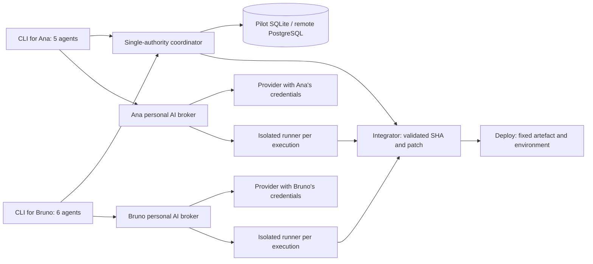
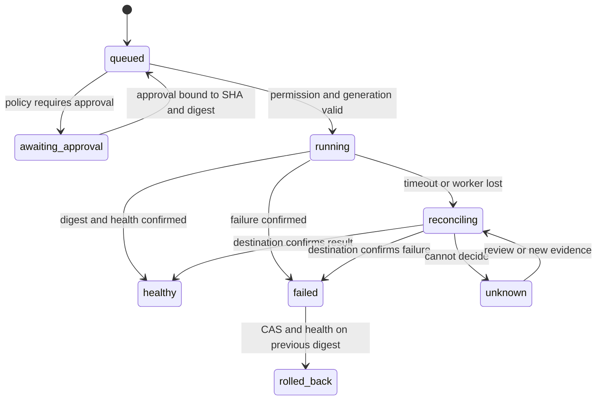

# CSHCLI — product, architecture, and implementation superplan

> **For agentic workers:** REQUIRED SUB-SKILL: Use superpowers:subagent-driven-development (recommended) or superpowers:executing-plans to implement this plan task-by-task. Steps use checkbox (`- [ ]`) syntax for tracking. The user's authorisations and preferences take precedence over the skill's procedure.

**Goal:** Build an AI CLI with personal credentials and shared projects that coordinates eleven agents, evolves toward isolated writes, and ships verifiable artefacts without races.

**Architecture:** Start with a Python CLI and a loopback HTTP coordinator backed by SQLite WAL, transactions, CAS memory, and leases with fences. Keep the `/v1` protocol independent of persistence so the service can migrate to HTTPS and PostgreSQL. Add the isolated runner, integration queue, and deployment in separate milestones with verifiable guarantees.

**Tech Stack:** Python >=3.11, standard library, local SQLite, `unittest`, `urllib`, `http.server`, `subprocess` without shell. PostgreSQL and the HTTPS service land in the remote phase; Git and GitHub Actions cover integration and delivery.

**Spec:** [../specs/2026-10-14-cshcli-design.md](../specs/2026-10-14-cshcli-design.md). HTTP contract: [../../PROTOCOL.md](../../PROTOCOL.md).

## Global constraints

- Python >= 3.11.
- Zero third-party runtime dependencies in the pilot.
- SQLite with WAL for local persistence; the database file stays on local disk.
- Pilot HTTP is loopback-only; all project routes require a bearer.
- Maximum HTTP body of 1 MiB.
- Default lease TTL of 120 seconds, range 1 to 3600 seconds.
- Default invitation TTL of 3600 seconds, range 1 to 604800 seconds.
- Only the owner can issue invitations or acquire `deploy:environment` leases.
- AI credentials belong to each user and never enter shared memory.
- A provider's native OAuth is not enabled without an official mechanism and verified eligibility.
- Guarantees about files and deployments are only announced when the runner and its integration make them hold.

---

## How to run and review the plan

The user's current priority is **to define a complete superplan**. Tasks 1–5 describe the first local cut whose base has already been started; its real state is documented in [STATUS.md](../../STATUS.md), the only reference for the implemented cut and its verifications. Tasks 6–11 are product evolution and remain pending until implemented and tested. Each task produces a usable deliverable; the full platform does not have to be deployed to validate the pilot. This plan does not by itself authorise infrastructure spend, service sign-ups, or production deployments.

Checkboxes represent work steps, not a promise that they are already done. The final verification must record which tests were run, on which Python version, and which features remain pending. Model and provider changes, and tests with real credentials, are reviewed outside CI to avoid cost and accidental exposure.

Work from the repository root. To run from source without installing:

```powershell
python scripts/cshcli.py --help
$env:PYTHONPATH = 'src'
python -m unittest discover -s tests -v
```

`pyproject.toml` also provides the `cshcli` command when the package is installed. The pilot does not need Docker, a remote database, or an AI provider to test coordination.

## Product vision, users, and non-goals

CSHCLI is the entry point for a team that wants to ship software with its own AI accounts without duplicating work or stepping on each other's changes. The owner controls the project, invites people, sets policies, and decides how to integrate and deploy. Each member picks their own provider and credentials, knows the cost of their tasks, and sees what the other agents are doing.

The collaboration unit is the **project**, bound to a Git repository and a versioned policy. The execution unit is the **task**, with agent, base SHA, resources, budget, and result. The integration unit is a **tested patch or commit**; the deployment unit is an **immutable artefact**. These units are not mixed into a memory blob.

The first product targets a small team of two to ten people with private projects and tens, not thousands, of agents. The first validation case is two people with eleven agents. A single user can also use it: the coordination model is the same.

The first product is not about sharing one subscription across people, training a proprietary model, replacing Git, offering an agent marketplace, brokering unauthorised credentials, running hostile code on personal machines, or promising universal deployment to any cloud. The first real deployment integration will have a concrete destination and a concrete rollback. The graphical interface is out of the critical path; the CLI must be enough to collaborate.

Success is measured by observable outcomes:

- Two people complete onboarding, invitation, repo association, and their first task without editing configuration manually.
- Eleven agents produce traceable changes; there are no silent overwrites and every conflict is logged.
- No stale process can apply a patch or modify an environment through a supported worker.
- The user can identify the responsible party, the SHA, the tests, the known or unknown cost, and the state of each task.
- A failed deployment lets the team recover the previous version through a rehearsed procedure.

## Priorities, size, and investment order

`P0` blocks the first reliable collaboration; `P1` enables useful team work and delivery; `P2` improves comfort, scale, or provider coverage. Size is relative: `S` is a small unit with a main interface, `M` is several operations of one component, `L` is integration between components, and `XL` is a subsystem with distributed failure modes. These are not promised dates. A spike measures the high uncertainties first before turning them into a calendar estimate.

| Package | Priority | Relative size | Dependency | Main uncertainty |
| --- | --- | --- | --- | --- |
| Protocol, local identities, and roles | P0 | M | None | Bootstrap ergonomics and token recovery |
| CAS memory and leases with fences | P0 | L | Identity | Prefix semantics and races in production |
| CLI, errors, and documentation | P0 | M | Protocol | Windows terminal compatibility |
| API keys and text wrappers | P0 | M | CLI | Flag and capability changes in the official CLIs |
| Worktrees and runner with enforcement | P0 | XL | Leases | Sandbox, arbitrary commands, filesystem, and platforms |
| HTTPS, PostgreSQL, and revocable sessions | P0 for two machines | XL | Stable protocol | Identity, operation, and recovery |
| DAG and integration queue | P1 | L | Runner and linked repo | Semantic compatibility between patches |
| First staging deploy and rollback | P1 | XL | Integration and concrete destination | Destination idempotence and external fencing |
| Agent limits and basic spend | P0 when running paid agents | M | Runner and providers | Incomplete usage or unpublished pricing |
| Eligible native OAuth | P2 | L | Provider registration | Eligibility and access conditions |
| More destinations, visualisations, and advanced metrics | P2 | L per integration | Stable prior product | Real demand and maintenance |

Recommended order after closing the plan: verify the pilot; run a sandbox spike and a PostgreSQL and races spike; deliver the isolated runner with a basic budget; enable two machines; add tasks and merge; connect staging; enable production under a policy; and expand native login only where eligible. Minimum budgets are introduced when paid tasks start, even though the full analytics live in task 11.

## Distribution and single source of truth

| Process | Where it lives | What it decides | What it persists |
| --- | --- | --- | --- |
| `cshcli` CLI | Each person's machine | Intent, provider, and presentation | Configuration, session reference, and personal cache |
| Local coordinator and daemon | One machine in the pilot | Roles, CAS, leases, and fences | Local SQLite and events |
| Remote coordination service | Project infrastructure | The same decisions for all machines | PostgreSQL, sessions, tasks, and policies |
| Runner | Isolated workspace per execution | Apply authorised tools while its run is valid | Worktree, sanitised logs, and artefacts |
| Personal inference broker | The user's machine or a private runner of their choice | Provider calls with their account and a limited tool channel | Account references and usage; keys only in the user's local store |
| Integrator | Isolated integration workspace | Result of checks and branch advance conditioned on SHA | Base and final SHA plus test results |
| Deploy worker | Execution environment with minimum credentials | Run one concrete approved request | Reconciled external state and active digest |

The **coordinator's transactional store is the authority** for resource ownership and state. Shared memory carries explanations and human decisions; it is not a lock table. The client does not decide a lock has expired from its own clock, does not delete a memory entry to free a resource, and does not substitute the coordinator's response for what another agent says. Git demonstrates content and commits; it does not grant a lease.

Every participant in a project uses the same coordinator and `project_id`. The future attach command checks the remote repository identity and records a base; creating two projects with the same name does not link them. There are not two local SQLite instances acting as the authority for the same remote project. Configuration explicitly shows the project, coordinator, and repo before starting a runner.

The pilot uses `cshcli serve` as a foreground process to ease inspection and shutdown. Later an optional daemon with `start/status/stop` will be added, without auto-starting a second coordinator when one is down. The remote service is deployed as an HTTP process behind TLS; runners and integrators scale independently of the process that decides leases.



The broker keeps provider API keys away from the coordinator and from the sandbox that runs repository code. It calls the provider from the user's machine and hands the runner a token scoped to the project, run, and capabilities. The runner returns sanitised results; tests and scripts do not inherit keys. A private runner under the user's control can host its own broker if the user chooses. A remote vault is a future, explicit mode with its own isolation, revocation, and retention; it is never the default.

An official CLI that does not allow mediating remote tools with guarantees stays as a text chat. Running Codex in read-only is not the same as already having a coordinated remote editor agent. The API modality with mediated tools can advance before the subscription CLI modality.

## Linked repository and SCM permissions

Initially each project has **one repository**, identified by the provider's stable ID when it exists, a canonical URL, and `integration_branch`. Forks and renames do not change that identity by name inference. The linked repository is verified when each checkout is attached; tasks and integration always record the base SHA. The pilot does not yet have this formal association.

The final flow will be `project create --repo` for a new project, `project attach --path` for an existing checkout, and `project clone --path` to fetch it. The CLI checks SCM provider access before accepting tasks; if that fails it shows that CSHCLI membership does not grant GitHub access. Changing the repo or integration branch requires the owner, an event, and revalidation of pending tasks; existing patches are not silently retargeted.

For the remote service we propose a GitHub App installed per repository with the minimum content, PR, and checks permissions each function needs. In local use, the user's Git authentication or a minimum-scope PAT in their personal store can be used without copying it to the coordinator as a general credential. SCM credentials, AI provider credentials, and deployment credentials are three independent scopes. No AI token is used to access GitHub.

## Memory, execution context, and human rules

| Layer | Content | Authority and scope |
| --- | --- | --- |
| Transactional state | Members, permissions, tasks, leases, budget, and deployments | Coordinator DB; only authorised operations change it |
| Shared knowledge | Decisions, contracts, evidence, and handoffs | Project versioned memory, with author and provenance |
| Private session | Personal conversation, drafts, and details of one execution | Private per user and run; not auto-published |

Internal model reasoning, secrets, and full conversations are not published as automatic memory. A knowledge promotion contains a useful summary with evidence and scope. The owner's rules in `AGENTS.md` or human policy load with explicit priority; retrieved content is labelled as data. Versioned human correction overrides agent summaries. A memory entry cannot modify permissions, spend caps, or authorise tools or deploys.

Entry evolution adds `kind` (`decision`, `contract`, `evidence`, `handoff`), `scope` (project, task, or resource), `status` (`proposed`, `verified`, `superseded`), `author`, `source_commit`, `evidence` references, `version`, and optional `expires_at`. Revisions and supersession relations are kept. `verified` requires human verification or registered evidence per type; it is not enough for the agent to write that word. The new fields are not assumed present in the pilot's plain memory.

The future `ContextAssembler` applies ACL **before** retrieving or indexing content, selects relevant rules and contracts, and generates a manifest per execution: keys and versions used, origin and commit, base SHA, policy review, context budget, and excluded documents. When a new task starts or the base changes it refreshes; during a task only relevant novelties are added with their version. Incremental sync uses a persistent revision and event cursor; a lost cursor forces a full authorised read.

Context has byte and token limits when reliable measurement exists. If it does not fit, the assembler keeps critical rules and contracts, summarises evidence, and marks omissions; it does not arbitrarily truncate instructions or JSON. We start with keys, scopes, and text search. Embeddings are added only if a real-world evaluation improves retrieval and cost while keeping ACL, deletion, and provenance.

## Final terminal UX — proposed, not yet implemented

The commands in this section define the desired flow. **They are not the help of the current pilot**; the pilot's existing commands are detailed in tasks 4 and 5. Before implementing each family, JSON format, exit codes, and the contract in the protocol are fixed. The CLI offers human output by default and `--json` for automation; `--no-input` avoids interactive prompts in CI.

| Moment | Proposed command | Visible result |
| --- | --- | --- |
| Enter the remote CSHCLI | `cshcli login --server https://team.example` | Account and server; credential stored locally |
| Create a project | `cshcli project create acme --repo https://github.com/team/acme.git` | Project ID, owner, and repo |
| Invite | `cshcli project invite acme --role member --ttl 86400` | One-use token, expiration, and role; sent outside the CLI |
| Accept | `cshcli project join --invite-stdin` | Membership, permissions, and coordinator |
| Attach a checkout | `cshcli project attach acme --path .` | Verified repo, branch, and reference SHA |
| Pick an AI | `cshcli provider login codex` or an env API key | Personal modality and available capabilities |
| Set a policy | `cshcli policy set acme --max-agents 11 --daily-budget 20 --currency EUR` | Policy proposed and stored by owner; 20 is an example, not a price |
| Create a task | `cshcli task add acme "Profile endpoint" --resource file:src/profile --resource file:tests/profile` | ID, resources, dependencies, and queued state |
| Run five agents | `cshcli agent start acme --count 5 --provider codex` | Runs, workspaces, queue, and reserved budget |
| Run six agents | `cshcli agent start acme --count 6 --provider anthropic --model MODEL` | Six runs under the second user's identity |
| Watch the team | `cshcli status acme --watch` | Agents, owners, tasks, conflicts, and known spend |
| Inspect context | `cshcli memory list acme` | Page and versions; content without secrets |
| Recover a failure | `cshcli task resume acme task-42` | New run, new fence, and previous artefacts available |
| Review a change | `cshcli task diff acme task-42` | Diff, base SHA, author, and checks |
| Integrate | `cshcli merge enqueue acme task-42` | Queue position and result by project |
| Promote to staging | `cshcli deploy request acme staging --sha SHA --artifact sha256:DIGEST --idempotency-key release-7` | Request and fixed artefact |
| Approve production | `cshcli deploy approve acme deploy-7` | Actor and approval policy |
| Recover an environment | `cshcli deploy rollback acme production --to sha256:PRIOR_DIGEST` | Auditable rollback request |
| Audit | `cshcli audit acme --task task-42 --json` | Events and references, without keys or prompts by default |

`MODEL`, `SHA`, and `DIGEST` are arguments the user picks or that a previous operation produces; they are not configuration values pending design. Model selection stays explicit for APIs; we do not pin a name that could become outdated. Policy amounts are limits the owner chooses, not provider rate estimates.

Resource errors show which scope is busy, by which run, and when it expires, without exposing data from another project. The CLI distinguishes `blocked_resource`, `blocked_dependency`, `budget_exceeded`, `coordinator_unavailable`, `provider_auth_failed`, and `review_required`. A blocked task is not presented as completed. Long-running operations print state and keep an ID that lets a later query resume after the terminal closes.

## Full walkthrough of two people with 5 + 6 agents

1. Ana creates `acme`, attaches the private repo, and sets member, agent, and production limits. If Bruno has no access to the GitHub repo, the system shows that requirement independently of his CSHCLI membership.
2. Ana issues a one-use member invitation. Bruno signs in with his identity, consumes it, and attaches his checkout of the same repo. Both see the same project, policies, and coordinator; each keeps their own AI credentials.
3. They store decisions in `architecture` and `acceptance/profile`, with versions. They create eleven small tasks: API, UI, tests, documentation, and an independent refactor. Two tasks that need the same module are made dependent or compete for its scope; full-repo parallelism is not promised.
4. Ana starts A1–A5 and Bruno starts B1–B6. The scheduler checks identity, budget, and slots. It only assigns ready tasks and creates a worktree from the registered SHA for each run.
5. A1 acquires `file:src/profile`; B1 needs `file:src/profile/routes.py`. The coordinator grants one request and blocks the other. B1 can take another ready task; the system does not shrink the namespace in secret to bypass the lease.
6. A2 and B2 work on disjoint scopes. Before each write, the runner validates context and lease; heartbeat renews. Changes stay in their own worktrees. A new decision uses CAS; a version conflict forces reconciliation of the content.
7. B3 loses connectivity. Its runner closes the write door, stops the process, and keeps the worktree. The task is marked interrupted, and when the lease expires another agent can acquire a new generation. B3 does not automatically re-apply its work when the network returns.
8. A1 delivers a commit against its base SHA. The system logs diff, resources actually touched, checks, and cost. If it touched paths outside the lease, the result is rejected or the agent must acquire those scopes and revalidate; permissions are not retroactively widened.
9. Ana, or the policy, queues integration. The integrator applies each patch over the final base, runs the checks again, and advances the branch with an SHA comparison. Incompatible changes go back to review; a different file lease does not prove semantic compatibility.
10. Once the tasks are integrated, the artefact is built for a concrete SHA. Ana requests staging with a digest and idempotency key. Two workers competing leave a single active attempt; a lost network response is reconciled by external ID.
11. The health check confirms staging. Production follows the project's approval policy; a member does not promote. If health fails, `failed` is recorded and the previous digest is deployed under the same environment control. Both see which version is active.
12. Unused budget is released and artefacts are archived per retention. The audit trail lets anyone reconstruct who produced, reviewed, integrated, and deployed each change. AI credentials never appear in that trail.

## Connectivity, failures, and write authority

| State | Allowed operations | Suspended operations | Recovery |
| --- | --- | --- | --- |
| Coordinator available | Read, CAS, acquire and renew, and execute by permission | Rejections by policy | Normal flow |
| Local cache only | Query context with an age indicator; plan; personal chat without tools | Acquire and renew, runner writes, merge, and deploy | Re-read state when the network returns |
| Renewal fails | Keep files and artefacts; query state | New write tools and result publication | Revalidate with a new lease and base SHA |
| AI provider down | Read state; keep the run | New generation by that provider | Limited backoff; fallback only if the policy allows destination and cost |
| Integrator down | Enqueue and view persisted state | Advance the branch without reconciling the attempt | Check the current SHA before resuming |
| Deploy worker down | Query the request and destination state | Blindly run another attempt | Reconcile the external operation and idempotence |

There is no guaranteed offline write mode against the shared project in v1. You can draft a proposal outside the runner, but importing it is a new patch that must acquire resources, compare bases, and pass checks. The client does not extend a TTL just because it is offline. The expiration clock is the coordinator's; the terminal countdowns are only orientation.

An HTTP check followed by a free write does not eliminate a race. The guarantee comes from combining: separate worktrees to avoid touching the same checkout, tools limited to the workspace, a runner that stops writing when it loses authorisation, and transactional or conditional verification at the point where the integrator or deployer publishes the result. If a deployment provider does not allow compare-and-set or fence checks, CSHCLI must serialise through a single proprietary adapter and reconcile before allowing replacement.

The mandatory acceptance test pauses an agent **after it validates**, lets its lease expire, grants a new generation to another agent, and then resumes the first. The first can keep artefacts but can never integrate or deploy. The `accept_patch` decision is serialised with the lease and run transition and the base comparison; it is not enough that a runner queried an endpoint seconds earlier.

## Revocation and minimum limits before running agents

The remote identity will have `authorization_generation` per user and agent, and runs will store the authorised generation. Revoking a member, session, or agent or changing policy increments the generation and invalidates capabilities. The service re-checks permissions when claiming a task, authorising tools, moving to review, integrating, and executing, approving, or recovering a deploy. Already-queued work does not keep old permissions indefinitely. Artefacts stay per retention, but a revoked user cannot keep reading them through a download token with no expiration.

Before the first consumption-capable runner, P0 limits are implemented. Initial configurable proposal: at most 11 active runs per project, 15 minutes per attempt, 20 inference calls per attempt, and 1 MiB captured per command stream. Context and model are also limited by the verified capabilities of the adapter. A monetary budget complements these limits and does not replace them; a slow call or an infinite output still has limits even when the price is unknown.

The consumption authorisation creates an idempotent reservation bound to `run_id` and attempt and period. Retrying the same operation does not duplicate the reservation or the settlement. A crash leaves the reservation recoverable: confirmed usage is reconciled, leftover balance is released, and the unmeasurable part is marked unknown. Unknown consumption is not turned into zero. For unknown pricing, the policy must explicitly allow that modality and keep finite request, time, and output limits; `unknown cost` is shown before starting.

Capabilities are recorded by **provider, modality, model, and version**: `verified` or `unknown` authentication, text, mediateable tools, sandbox, streaming, context and output limits, and usage and price availability. `configured=true` means configuration exists, not that login, credit, or model are verified. Unknown data stays unknown and is not turned into `false` or an invented rate. The runner only enables tools whose capability it has verified.

## Sandbox and platforms: scope of the guarantee

The CLI and the protocol are supported on Windows, Linux, and macOS. The first runner with arbitrary execution and isolation guarantees is proposed as **managed on Linux**, in containers or VMs with verified controls. A Windows user can drive it from their terminal. A native Windows or macOS runner will not be advertised as equivalent until its specific controls are verified; meanwhile it admits reading, chat, and worktree utilities, with the indicated limits.

The sandbox receives only the task checkout with write access, a temporary root, and the needed tools. The host filesystem and the integration checkout are not mounted; it does not receive a Docker socket, an SSH agent, or production credentials. The network is disabled by default; provider access goes through a policy-bound channel with a minimum secret. Privileges are disabled, CPU, memory, and process limits are set, and the runner is validated to make sure a subprocess cannot escape via symlink, junction, procfs, or an unexpected mount.

The worktree avoids content collisions but is not a sandbox by itself: it shares Git objects and a process with user permissions can access other directories. For arbitrary execution the checkout is materialised and exported inside the isolation and a patch or commit is produced as an artefact; integration happens outside, in a different worker. Project scripts and tests count as code that can act, not just reads.

Before the milestone, negative tests run: read a host decoy file, write to a neighbouring checkout, open a forbidden socket, access a decoy secret, exhaust processes, and apply an external symlink. The result must be denial and an event; a simple `Path.resolve()` assert does not prove this sandbox.

## Recovery and split-brain in integration and deploy

The remote service uses a single-authority database with transactions. Read replicas never grant leases. The project or environment row is locked to decide the owner and generation; no in-memory lock inside an HTTP process is used. A network partition does not authorise another node to create a local counter.

A worker takes a persisted request through a conditional transition to `running`, records its `worker_id`, generation, and attempt identifier, and renews. Another worker can pick up work after expiration, but only after querying the external state. A stale worker cannot report success for a new generation or change the state of a request whose attempt it no longer owns.

Approvals are bound to the immutable set `project_id + environment + commit_sha + artifact_digest + policy_revision`. Changing any of these invalidates the approval. In addition to `queued`, `running`, `healthy`, `failed`, and `rolled_back`, deployment has `awaiting_approval`, `reconciling`, and `unknown`; the system does not present an ambiguous state as a safe failure that lets a blind re-run happen.

The ideal destination API accepts an idempotency key and version comparison. If not, the adapter keeps a single write point per environment, checks state before recovery, and stops promotions while an ambiguous attempt is in progress. We do not claim exactly one physical execution if the external API does not allow it; we do keep a single logical intent, its reconciliation, and an explicit state that requires review when it cannot be decided.

Rollback does not erase history: it creates a request with the previous digest, actor, and reason. It can fail and needs its own health test. The system avoids marking `rolled_back` until it confirms which version the destination serves. Staging credentials do not authorise production, and agents that generate code do not receive deploy credentials.

A late rollback from A cannot undo a deploy B that is already healthy. Every environment change compares `active_deployment_id`, `expected_digest`, and environment generation. If it has already changed, A is stale and needs a new approved intent; it does not run a restore based on the state it remembered before the failure.



## Migrating from SQLite to PostgreSQL without two authorities

1. Stabilise the `/v1` contract and run the same permission, CAS, prefix, TTL, and fence tests against both stores.
2. Create migrations with schema version, constraints, and indexes. In PostgreSQL, acquisition locks the project row to cover prefixes; validate performance before trying finer granularity.
3. Prepare an importer that keeps IDs, memberships, memory versions, and audit. Adjust the fence sequence above the imported maximum. Tokens may require session reset under the remote model; that change is announced before migrating.
4. Put the local project in maintenance mode: do not accept new writes or acquisitions; stop runners and wait for or release leases. Export a consistent backup through the SQLite backup API, not just by copying `.sqlite3` and ignoring WAL.
5. Import in a single transaction, compare counts and checksums, and run read and authorisation tests. Invalidate prior leases; resumed runs acquire new generations and revalidate the base.
6. Switch the coordination URL once; the old coordinator stays read-only or is closed. Do not dual-write locks. Document the timestamp and the new authority.
7. Test onboarding and invitation, CAS, and the eleven-client race from two machines. Keep an encrypted backup and a migration log per retention.
8. If the check fails before cutover, go back to the local backup. If PostgreSQL already received changes, do not reopen the old SQLite as the authority: export and reconcile those changes through a revised procedure and a new maintenance cutover.

## Definition of done per delivery and compatibility

A task is done when its behaviour passes positive and negative tests, its interface and permissions are documented, it does not introduce secrets, and its limitations are visible. A remote milestone also needs reproducible deployment, backup and restore, observability, and a recovery procedure; a provider milestone needs capabilities and conditions verified against official documentation.

The early versions are alpha `0.x`. The protocol has its own version: keeping `/v1` requires backwards-compatible additions; an incompatible change gets a new version and a coexistence period. Each client sends its version and capabilities; the server may reject a version that does not understand required fences or policies. Migrations record schema version and are rehearsed with data from the prior release.

The release matrix includes the declared minimum Python and Windows, Linux, and macOS for the CLI. Runner capabilities are published per platform; they are not inferred from the help working. Pinned, tested versions of the official CLIs are used and their flags are queried at run time. An upstream change without a safe mode causes an explicit rejection, not a silent loss of controls. Releases include a changelog, checksums, and an update and revert procedure; a runner is not updated in the middle of an active attempt.

## Open decisions with a starting proposal

These decisions do not block drafting or the pilot. They are resolved when the corresponding milestone opens; the proposal lets cost and scope be compared without inventing a user preference.

| Decision | Starting proposal | Closing moment | Evidence to decide |
| --- | --- | --- | --- |
| Coordinator hosting | Self-hosted service per project or team; managed PostgreSQL if it fits | Before the remote milestone | Real monthly cost, backups, and access needs |
| Remote CSHCLI identity | Native login through an authorised OIDC provider; AI account separate | Remote milestone design | Onboarding ease, revocation, and availability |
| Initial strict runner | Managed Linux; CLI on three platforms | Sandbox spike | Escape tests and cost or latency |
| Git access | Minimum credential per repo and user or service; no account-wide token | Integration milestone | Required permissions and revocation |
| First deploy destination | One staging with idempotent API and digest-based artefacts | Before task 9 | Real project environment and verifiable rollback |
| Production approval | Owner approves; automation only by explicit policy | Before the first production deploy | Destination risk and rollback capacity |
| Who pays for AI | Each person pays their provider; project limits coordinate use | Before paid tasks | Account modalities and team policy |
| Public distribution and license | Publish CSHCLI under the OSI MIT license, chosen by the owner | Open source preparation | Public repository, license, and reproducible guide |
| Prompt and artefact retention | Do not store prompts in audit by default; artefacts under explicit policy | Before remote service | Debugging need, sensitive data, and storage |
| Native OAuth | Only when the client meets official requirements | Task 10 | Approved registration and documented capabilities |

No provider rates are fixed in this plan: they change and depend on modality, model, and unit. The product budget will carry prices with a source and date, real costs when they exist, and unknown state when they cannot be calculated.

## File and dependency map

| File | Responsibility | Milestone status |
| --- | --- | --- |
| `pyproject.toml` | Package, minimum Python, and entrypoint | Pilot |
| `scripts/cshcli.py` | Run from source without installing | Pilot |
| `src/cshcli/__init__.py`, `__main__.py` | Module version and entry | Pilot |
| `src/cshcli/errors.py` | Domain error with status, code, and message | Pilot |
| `src/cshcli/store.py` | SQLite, identity, projects, invitations, CAS, leases, and events | Pilot |
| `src/cshcli/server.py` | HTTP, limits, authentication, routes, and loopback | Pilot |
| `src/cshcli/client.py` | HTTP transport and error translation | Pilot |
| `src/cshcli/cli.py` | Parsing and commands | Pilot |
| `src/cshcli/providers.py` | AI API and official CLI wrappers | Pilot |
| `tests/test_store.py` | Races, permissions, TTL, and persistence | Pilot |
| `tests/test_server.py` | Real HTTP contract | Pilot |
| `tests/test_providers.py` | Mocked requests and subprocesses | Pilot |
| `tests/test_cli.py` | CLI flow, credentials, and errors | Pilot |
| `.gitignore`, `.env.example`, `AGENTS.md`, `README.md` | Use, limits, visible rules, and excluded secrets | Pilot |
| `.github/workflows/ci.yml` | Active CI on Windows and Linux with Python 3.11, 3.12 and 3.13 | Active |
| `src/cshcli/runner.py`, `workspace.py` | Mediated writes, worktrees, and heartbeat | Isolation milestone |
| `src/cshcli/context.py`, `broker.py` | Context manifest and personal AI call without keys in the sandbox | Isolation milestone |
| `src/cshcli/tasks.py`, `integration.py` | DAG and merge queue | Flow milestone |
| `src/cshcli/remote/` | PostgreSQL persistence, identity, and HTTPS deployment | Remote milestone |
| `src/cshcli/deploy.py` | Queue, worker, and artefact rollback | Deployment milestone |
| `src/cshcli/usage.py`, `policy.py` | Consumption and budgets | Operational milestone |

Pilot order: `errors → store → server → client/CLI`; `providers → CLI`. Isolation and integration order: **6A → 6B → 8A → 6C → 8B → 9**. Remote task 7 can advance in parallel once the contract is stable and must finish before cross-machine collaboration is offered. 8A is the minimum acceptance gate, independent of the full DAG and queue in 8B; that way there is no circular dependency with the runner. Shared contract changes are communicated before editing neighbouring modules.

## Task 1: Persistent identities and projects

**Files:** create `src/cshcli/errors.py`, `src/cshcli/store.py`, `tests/test_store.py`; configure `pyproject.toml`.

**Inputs consumed:** `pathlib.Path`, `sqlite3`, `secrets`, `hashlib`, `time.time`, and `typing.Callable` from the standard library.

**Outputs produced:**

```text
DomainError(status: int, code: str, message: str)
Store(db_path: str | Path, clock: Callable[[], float] = time.time)
Store.register_user(name: str) -> dict
Store.authenticate(token: str) -> str
Store.create_project(user_id: str, name: str) -> dict
Store.list_projects(user_id: str) -> list[dict]
```

- [ ] Add tests for persistence, duplicate name by `casefold()`, invalid authentication, empty or control names, and a private project. Run the test and confirm it fails because there is no implementation:

```powershell
$env:PYTHONPATH = 'src'
python -m unittest tests.test_store.StoreTests.test_identity_is_persistent_unique_and_authenticates_hashed_tokens -v
```

- [ ] Create tables and indexes with active foreign keys, `journal_mode=WAL`, and a finite SQLite timeout. Emit a random secret and store its digest, never the secret. The core operation is:

```python
token = secrets.token_urlsafe(32)
token_hash = hashlib.sha256(token.encode('utf-8')).hexdigest()
```

- [ ] Validate `name` before the transaction: user 1–80 characters, project 1–120, no controls, and not pure whitespace. Create the project and the owner membership in a single transaction. Convert duplicates to `409 name_taken` and an invalid token to `401 invalid_token`.

- [ ] Run identity, listing, and permission tests. Inspect the database dump with this assertion inside `test_store.py`:

```python
with sqlite3.connect(self.path) as connection:
    dump = '\n'.join(connection.iterdump())
self.assertNotIn(self.owner['token'], dump)
self.assertIn(hashlib.sha256(self.owner['token'].encode()).hexdigest(), dump)
```

**Acceptance:** restarting `Store` keeps identity and projects; listing never includes a non-member's project; tokens do not appear in SQL. Review and save a cohesive commit once the tests pass.

## Task 2: Roles, invitations, and CAS memory

**Files:** modify `src/cshcli/store.py`; extend `tests/test_store.py`.

**Inputs consumed:** `Store.authenticate`, the user, project, and membership tables, and `DomainError` from task 1.

**Outputs produced:**

```text
Store.create_invite(user_id: str, project_id: str, role: str = 'member', ttl: int = 3600) -> dict
Store.accept_invite(user_id: str, token: str) -> dict
Store.list_memory(user_id: str, project_id: str) -> list[dict]
Store.list_memory_page(user_id: str, project_id: str, limit: int = 10, after: str | None = None) -> dict
Store.put_memory(user_id: str, project_id: str, key: str, content: str, expected_version: int) -> dict
Store.list_events(user_id: str, project_id: str, limit: int = 100) -> list[dict]
```

- [ ] Add viewer, outsider, one-use and expired invitation, owner preservation, and CAS tests. Create eleven users that try to consume the same token using `Barrier(11)` and `ThreadPoolExecutor(max_workers=11)`. Assert one success and ten `409`.

- [ ] Run the cases before implementing:

```powershell
python -m unittest tests.test_store.StoreTests.test_concurrent_invitation_acceptance_has_exactly_one_winner tests.test_store.StoreTests.test_concurrent_memory_cas_prevents_lost_updates -v
```

- [ ] Implement authorisation on every operation. In an immediate transaction, check the invitation token, `used_by`, and `expires_at`, add the membership, and mark usage. Use a strict integer TTL inside 1–604800; reject `owner` as an invitation role. The consumption check is:

```python
expired = now >= invite['expires_at']
consumed = invite['used_by'] is not None
```

- [ ] In memory, compare the stored version with `expected_version` inside the same transaction that writes and records `memory.updated`. Missing key equals version 0. The new version is `current_version + 1`; a mismatch produces `409 version_conflict` and does not write. Add `list_memory_page` with `limit=1..10`, exclusive `after`, key order, and `limit+1` rows to compute `next_cursor`; keep `list_memory` for domain and internal tests.

- [ ] Run permission, invitation, CAS, and event tests. Add an audit assertion that no secrets or content appear:

```python
serialized = json.dumps(self.store.list_events(self.viewer['id'], self.project['id']))
self.assertNotIn(self.owner['token'], serialized)
self.assertNotIn('PRIVATE-CONTENT', serialized)
```

**Acceptance:** eleven writes at initial version 0 leave a single entry at version 1; the viewer only reads; an unknown, expired, or used invitation responds explicitly. Review and save a commit once the tests pass.

## Task 3: Transactional leases and fences

**Files:** modify `src/cshcli/store.py`; extend `tests/test_store.py`.

**Inputs consumed:** authorisation and events from tasks 1–2; injectable clock for expiration tests.

**Outputs produced:**

```text
Store.acquire_leases(user_id: str, project_id: str, agent_id: str, resources: list[str], ttl: int = 120) -> list[dict]
Store.list_leases(user_id: str, project_id: str) -> list[dict]
Store.renew_lease(user_id: str, project_id: str, lease_id: str, fence: int, ttl: int = 120) -> dict
Store.release_lease(user_id: str, project_id: str, lease_id: str, fence: int) -> dict
```

- [ ] Write tests for eleven agents split five and six across owner and member, prefixes, casefold, atomic batch, TTL, fence after restart, and lease ownership. Run:

```powershell
python -m unittest tests.test_store.StoreTests.test_eleven_agents_across_two_users_have_one_lease_winner tests.test_store.StoreTests.test_batch_acquisition_is_atomic_when_any_resource_conflicts -v
```

- [ ] Implement canonical resources. Reject non-relative paths, `\`, `.`, `..`, double `/`, ambiguous suffixes, reserved Windows names, and duplicate or overlapping resources in one batch. For two already validated paths, the prefix conflict is decided by segment boundaries:

```python
conflict = left == right or left.startswith(right + '/') or right.startswith(left + '/')
```

- [ ] Inside an immediate transaction, read the project's active leases (`expires_at > now`), check all resources, increment the persistent sequence, and insert one row per resource. If there is a conflict, roll back the whole batch. Reserving `deploy:*` requires the owner and compares exact normalised environments.

- [ ] Implement renewal and release by checking project, owner, `expires_at > now`, and exact fence. Validate a positive integer fence and an integer TTL of 1–3600. Renewal keeps the fence; a new acquisition gets a higher one. Do not reset the sequence on release or expiration.

- [ ] Run all store tests and verify the race result:

```python
self.assertEqual(sum(status == 'ok' for status, _ in results), 1)
self.assertEqual(sum(status == 409 for status, _ in results), 10)
self.assertEqual(len(self.store.list_leases(self.owner['id'], self.project['id'])), 1)
```

**Acceptance:** there are never two active leases of overlapping resources; expiration frees availability; a former holder cannot renew or release a new lease; non-members and viewers cannot mutate. The tests do not assert filesystem blocking. Review and save a commit once the tests pass.

## Task 4: HTTP server and usable CLI

**Files:** create `src/cshcli/server.py`, `client.py`, `cli.py`, `__main__.py`, `scripts/cshcli.py`, `tests/test_server.py`, `tests/test_cli.py`; document `docs/PROTOCOL.md` and `README.md`.

**Inputs consumed:** `Store` methods from tasks 1–3 and `DomainError`.

**Outputs produced:**

```text
make_server(db_path: str | Path, host: str = '127.0.0.1', port: int = 8765) -> Coordinator
Coordinator.serve_forever() -> None
Coordinator.shutdown() -> None
Coordinator.server_close() -> None
Client(url: str = 'http://127.0.0.1:8765', token: str | None = None)
Client.request(method: str, path: str, body: dict | None = None) -> dict | list
main(argv: list[str] | None = None) -> int
```

- [ ] Create HTTP tests with an ephemeral port `port=0`, a server thread, and `urllib.request`, without external network. Check the two-identity flow, authentication, invalid JSON, rejection of public Origin and Host, and `0.0.0.0` bind.

- [ ] Run `python -m unittest tests.test_server -v` and record the initial failure. Implement dispatch per `docs/PROTOCOL.md`, status 201 for registrations, projects, invitations, and acquisitions, and 200 for the other operations. Translate `DomainError` into the `error` envelope; do not return tracebacks or SQL.

- [ ] Validate `Content-Length` before reading a body larger than 1 MiB and require a JSON object. Keep the bearer out of logs. Limit the pilot bind and transport to loopback. The client does not follow a redirect that could forward credentials to another host.

- [ ] Implement the CLI parser with these exact commands:

```text
serve --db .cshcli/coordinator.sqlite3 --port 8765
auth register NAME
project create NAME
project list
project invite PROJECT --role member --ttl 3600
project join [--invite-stdin]
memory list PROJECT [--limit 10] [--after KEY]
memory put PROJECT KEY (--content TEXT | --file FILE) --expected-version N
lease acquire PROJECT AGENT RESOURCE... --ttl 120
lease list PROJECT
lease renew PROJECT LEASE_ID FENCE --ttl 120
lease release PROJECT LEASE_ID FENCE
deploy reserve PROJECT ENV --agent AGENT --ttl 120
events PROJECT
```

- [ ] Persist personal configuration outside the repository. Global `--url` or `CSHCLI_URL` picks the coordinator; `CSHCLI_TOKEN` provides the coordination bearer. `project join` reads the token with `getpass` or stdin to avoid putting it in visible process arguments. `deploy reserve` only acquires `deploy:ENV` and must say so in its help and output.

- [ ] Run HTTP and CLI tests and smoke-test with two terminals using test registrations. Try eleven memory entries of 256 KiB: the first page must contain ten entries and `next_cursor`, the second the remaining one, with no JSON truncation. HTTP returns `data.items` and `data.next_cursor`; the CLI shows that page explicitly and the client rejects responses over 32 MiB with `response_too_large`. Confirm that `python scripts/cshcli.py --help` works without installing and that errors return a non-zero exit code.

**Acceptance:** the CLI and HTTP let the local flow run without editing the database, and the published limits match the behaviour. Review and save a commit once the tests pass.

## Task 5: AI with personal credentials, distribution, and CI

**Files:** create `src/cshcli/providers.py`, `tests/test_providers.py`, `.env.example`, `.gitignore`, `.github/workflows/ci.yml`, `AGENTS.md`; extend `src/cshcli/cli.py`, `tests/test_cli.py`, `README.md`. The first delivery keeps the workflow as `docs/templates/ci.yml.example` until the publish permission is available.

**Inputs consumed:** `urllib.request`, `subprocess.run`, `shutil.which`, environment variables, and `DomainError`. No adapter receives credentials from the coordinator.

**Outputs produced:**

```text
providers.chat(provider: str, model: str | None, prompt: str) -> str
providers.login(provider: str) -> int
providers.status() -> list[dict]
```

- [ ] Create tests with mocked HTTP and subprocesses: missing key, missing model, payload, timeout, remote 401 without leaking the body, incomplete response, missing CLI, version without flags, and delegated interactive login. Run `python -m unittest tests.test_providers -v` before implementing.

- [ ] Implement the OpenAI Responses, Anthropic Messages, and Google `generateContent` APIs over HTTPS. Read `OPENAI_API_KEY`, `ANTHROPIC_API_KEY`, and `GEMINI_API_KEY` from the environment only. OpenAI uses `store: false`; Google sends the key in a header, not in the query string. Do not enable tools in text-only API calls.

- [ ] Implement official wrappers without `shell=True`. Receive the prompt on stdin, query version flags, and reject chat if the text-only controls without tools are missing. Delegate login with the inherited terminal: `codex login`, `claude auth login`, and the official Gemini flow. Do not read the provider's private token files.

- [ ] Add commands:

```text
provider login {codex,claude,gemini}
provider status
chat --provider {openai,anthropic,google,codex,claude-code,gemini-cli} [--model MODEL] PROMPT
```

The Gemini CLI adapter returns `text_mode_unavailable` without running chat; the Google API is available with a key. Codex and Claude return `cli_version_unsupported` if their required flags are not verified. Errors do not contain stderr, remote bodies, or key values. `provider status` only exposes installation, configuration, and public metadata.

- [ ] Add CI on Python 3.11, 3.12, and 3.13 running tests without credentials. `.gitignore` excludes `.cshcli/`, `.env`, `.venv/`, SQLite and WAL, caches, and local credentials. `.env.example` only contains empty variable names.

- [ ] Run the full suite and compilation:

```powershell
$env:PYTHONPATH = 'src'
python -m unittest discover -s tests -v
python -m compileall -q src scripts
python scripts/cshcli.py provider status
```

- [ ] Publish `jtpydk5gyh-alt/cshcli` as a public repository under the OSI MIT license, check visibility, license, and remote, and save changes in coherent commits through a PR. Do not add secrets, private memory, local configuration, or test databases. Record the alpha version and pending features in the README.

**Acceptance:** coordination and provider tests pass without an external account; a clean install shows the help; the public repo contains the license, code, design, protocol, and plan. A real AI test is optional and must name the provider and model and the account that bears the cost.

## Task 6: Runner with mediated writes and worktrees

**Files:** create `src/cshcli/workspace.py`, `runner.py`, `context.py`, `broker.py`, `policy.py`, `tests/test_workspace.py`, `tests/test_runner.py`, `tests/test_context.py`, `tests/test_broker.py`, `tests/test_policy.py`; extend `store.py`, `server.py`, `client.py`, `cli.py`, and `docs/PROTOCOL.md`.

**Inputs consumed:** `Client.request`, v1 leases and fences, and the Git CLI with argv and a fixed base SHA.

**Outputs produced for this milestone:**

```text
Workspace.create(repo: Path, base_sha: str, run_id: str) -> Workspace
Workspace.resolve(relative_path: str) -> Path
Workspace.apply_patch(patch: bytes, base_sha: str) -> str
Store.validate_lease(user_id: str, project_id: str, lease_id: str, fence: int, resource: str) -> dict
Runner(client: Client, workspace: Workspace, heartbeat_seconds: int = 30)
Runner.write_file(relative_path: str, content: bytes, lease_id: str, fence: int) -> None
Runner.stop() -> None
ContextAssembler.build(user_id: str, project_id: str, task_id: str, base_sha: str, context_budget_bytes: int, after_revision: int | None = None) -> dict
Broker.generate(run_id: str, provider: str, model: str, context_manifest: dict) -> dict
providers.capabilities(provider: str, mode: str, model: str | None = None, cli_version: str | None = None) -> dict
Policy.reserve_run(user_id: str, project_id: str, run_id: str, authorization_generation: int, limits: dict) -> dict
Policy.finish_run(run_id: str, attempt_id: str, measured_usage: dict) -> dict
```

`POST /v1/projects/{id}/leases/{lease_id}/validate` with `{fence, resource}` is added. This validation alone is not enough to guarantee a write: the runner must keep exclusive access to its workspace and the integrator will check again when applying the patch.

This XL task is delivered in three reviewable cuts: **6A** context, broker, and limits without running code; **6B** sandbox and workspace with negative tests; **6C** mediated tools, heartbeat, and conditional publishing. Each cut keeps its tests and can be rejected without blocking the prior ones. Between 6B and 6C we implement **8A**, the minimum `Store.accept_patch` gate that does not need a complete runner, DAG, or merge queue. Before having a publisher with that guarantee, only review artefacts are exported and no patch is applied to the integration checkout.

- [ ] In 6A, add rich memory revisions and `ContextAssembler`: test ACL before search, prioritised human rules, excluded superseded, a stable manifest of versions, and omissions by budget. Test that a memory text that asks to raise permissions or spend more does not change the policy.

- [ ] In 6A, test the broker with decoys: the provider call stays on the user's machine, the runner only gets a scoped `run_id` token and no script inherits `OPENAI_API_KEY` or other keys. Reserve idempotent limits before inference and test crash and retry, unknown price, and max agents. Do not start a paid runner without this cut.

- [ ] Write worktree creation tests against an SHA and isolation of two runs. In a temporary repository, edit `src/a.py` in A and check that B and the integration checkout keep the original content.

- [ ] Write tests for rejection of absolute path, `..`, external symlink or junction, rename outside scope, expired fence, and heartbeat loss. On Windows, create a junction only when allowed; a skipped test must state the reason and finish on a capable CI or platform.

```python
with self.assertRaises(DomainError):
    runner.write_file('../outside.txt', b'escape', lease['id'], lease['fence'])
self.assertFalse(outside.exists())
```

- [ ] Create the worktree with `git worktree add --detach <unique-path> <base_sha>` and record the path and `run_id`. Resolve the real path against the real root; reject any external target. Use exclusive access and operations that avoid symlink replacement between check and write. Do not give the subprocess access to the shared checkout.

- [ ] Add a 30-second heartbeat for a 120-second TTL. If renewal fails or coordination is lost, close the write door, cancel the subprocess, and keep the artefacts. Check lease and fence before writing and before accepting a patch; do not extend the TTL locally.

- [ ] Expose only mediated read and write tools. Run arbitrary commands only in a sandbox that blocks access to the integration checkout and secrets. If a CLI does not allow that isolation, keep it in chat mode until the sandbox is available.

- [ ] Run `python -m unittest tests.test_workspace tests.test_runner -v`; kill a runner during a pending write and check that the lease expires and a new holder does not accept the previous fence. Review and save a commit.

- [ ] In 6C, run the pause-after-validate → expiration → new generation → resume test. The old process's publish must fail even if it had validated earlier. Also run the host read, neighbour filesystem, network, and decoy secret tests described in the sandbox section; record controls per platform.

**Acceptance:** no agent can write the shared checkout through granted tools; A does not step on B; a disconnected runner stops writing. The documentation replaces the cooperative limit only for operations that already go through this runner.

## Task 7: Remote service with revocable identity

**Files:** create `src/cshcli/remote/{database,identity,server}.py`, `migrations/001_remote.sql`, `tests/test_remote.py`, `tests/test_remote_postgres.py`, `deploy/compose.yaml`, `docs/OPERATIONS.md`; extend the client and configuration.

**Inputs consumed:** the `/v1` contract, domain models, per-project authorisation, and the existing CAS and fence semantics. Remote service dependencies are declared as extras; the local client keeps the dependency-free core.

**Outputs produced:**

```text
RemoteStore(dsn: str, clock: Callable[[], float] = time.time)
RemoteStore.acquire_leases(user_id: str, project_id: str, agent_id: str, resources: list[str], ttl: int = 120) -> list[dict]
Identity.issue_session(user_id: str, ttl: int) -> dict
Identity.revoke_session(actor_id: str, session_id: str) -> None
Identity.authenticate(token: str) -> str
Identity.revoke_agent(actor_id: str, project_id: str, agent_id: str) -> dict
Identity.authorization_generation(user_id: str, project_id: str, agent_id: str) -> int
```

- [ ] Create contract tests executed against both the local `Store` and `RemoteStore`. Against a real PostgreSQL, launch eleven independent processes on `file:src` and `file:src/a.py` and require a single winner; do not replace this test with a mock.

- [ ] Migrate the model to PostgreSQL with membership and version constraints. Serialise acquisition per project by transactionally locking the project row before querying or inserting resources, so prefixes that would sit in different rows are covered. Assign fences with a persistent sequence and log the event in the same transaction.

```sql
SELECT id FROM projects WHERE id = %s FOR UPDATE;
```

- [ ] Replace open local registration with verified identity and sessions with hash, expiration, and revocation. Add member and agent revocation with `authorization_generation` and check it before tools, review, merge, and deploy, including jobs queued before the revocation. Do not let an invitation grant extra privileges. The AI token stays on the user's device. Test revocation with a running task, a queued merge, and a deploy awaiting approval: all keep artefacts, none produce new effects.

- [ ] Deploy behind HTTPS with the database on a private network, request limits, timeout, and logging without secrets. Allow the remote client only HTTPS to non-loopback destinations and validate certificates. Configure automatic backups and run a restore on an empty database before inviting real users.

- [ ] Test two machines and accounts with different projects: cross access is always rejected, a revoked session stops working, concurrent CAS has a winner, and a worker crash releases the TTL. Measure read and acquisition latency percentiles with eleven clients and record the test environment.

- [ ] Document the migration, schema rollback, and recovery procedure. Run the local and remote suite and a permission review before publishing the endpoint. Save a commit and a deployment with a versioned identifier.

**Acceptance:** real remote collaboration over HTTPS, isolation between projects, and a demonstrated restore. The SQLite pilot is not exposed to fake this milestone.

## Task 8: Task DAG and integration queue per SHA

**Files:** create `src/cshcli/tasks.py`, `integration.py`, `tests/test_tasks.py`, `tests/test_integration.py`; extend the store and remote, CLI, and protocol.

**Inputs consumed:** 8A consumes context and identity from 6A, isolated workspace from 6B, authorisation and persistence, and Git with SHA; it does not need a complete runner. 8B consumes runner 6C and the 8A gate to add the DAG and queue. In remote it also consumes task 7.

**Outputs produced:**

```text
TaskService.create(user_id: str, project_id: str, title: str, dependencies: list[str], resources: list[str]) -> dict
TaskService.claim(user_id: str, task_id: str, agent_id: str) -> dict
TaskService.complete(user_id: str, task_id: str, commit_sha: str, base_sha: str) -> dict
TaskService.link_repository(owner_id: str, project_id: str, scm_repository_id: str, canonical_url: str, integration_branch: str) -> dict
Store.accept_patch(user_id: str, project_id: str, run_id: str, authorization_generation: int, lease_fences: dict[str, int], base_sha: str, commit_sha: str) -> dict
IntegrationQueue.submit(project_id: str, task_id: str, base_sha: str, commit_sha: str) -> dict
IntegrationQueue.process_next(project_id: str) -> dict
IntegrationQueue.accept_patch(user_id: str, project_id: str, run_id: str, authorization_generation: int, lease_fences: dict[str, int], base_sha: str, commit_sha: str) -> dict
```

**Cuts and order:** 8A produces `Store.accept_patch` and its `IntegrationQueue.accept_patch` wrapper, tied to repo and base, and tested against fences and TOCTOU; it finishes before 6C. 8B produces `TaskService`, `submit`, `process_next`, and the full DAG and queue after 6C. The gate tests do not need to run models or plan tasks; they use test runs and artefacts.

- [ ] Write tests for cycles in the DAG, failed dependency, double claim, cancelled task, and busy resource. Assert that `claim` does not move to running until dependencies are merged and leases are acquired atomically.

- [ ] Implement the states `queued`, `running`, `blocked`, `review`, `merged`, `failed`, and `cancelled`. Store the author, assignee, base SHA, resources, and dependencies. Validate cycles on create and modify; a block does not delete the task and does not allow skipping permissions.

- [ ] Implement one stable repo and integration branch per project; check SCM access on attach and clone. Test wrong repo, similarly named fork, changed branch, and invited user without GitHub permission. Changing the link revalidates tasks and does not move commits to another repository.

- [ ] Write a test with two patches based on the same SHA. The first modifies a function and the second its tests. Integrate the first, recompute the final base for the second, and run the tests on the composed result. Conflict or failure leaves `review` or `failed`, never a silent merge.

```python
result = queue.process_next(project_id)
self.assertEqual(result['tested_sha'], result['merge_sha'])
self.assertTrue(result['checks_passed'])
```

- [ ] Serialise integration per project, validate commits and base, apply the patch in a dedicated checkout, run the required checks, and advance the integration branch only if it is still on the expected SHA. Record the tested and merged SHA. Do not run `git reset --hard` against the user's workspace.

- [ ] Make `accept_patch` the serialised authority for publishing: check the authorisation generation, the run state, the resources actually modified, the fences, and the SHA in the same conditional acceptance decision. Test an expired lease after a prior validation and revocation during review; the integration checkout does not change.

- [ ] Run eleven tasks with a five-six split: at least two overlapping files, two conflicting CAS entries, and one failed dependency. Check that all results are merged or have an explicit block or error, with no lost changes. Run the suite and save a commit.

**Acceptance:** every merged commit has a base, author, task, and test result; the integration order is traceable; semantic collisions fail visibly.

### Handoff between execution, review, and integration

The runner keeps its leases during the run and the initial delivery. `accept_patch` checks live fences and records an accepted immutable artefact; that transition and the release of resources are logged together. An acceptance is not a merge and does not keep a file reserved for hours of human review.

When the integrator takes the artefact, it gets **new leases under its limited service identity**, re-checks the author's authorisation, the base, and every affected file, and runs the checks on the composed result. It never reuses a released generation fence. The single publish gate serialises the decision and the conditional update of the Git reference; long tests happen before that short operation, and any base change forces them to be recomputed.

If the runner's lease expires before its delivery is accepted, the draft is kept but requires a new acquisition and validation. If a member is revoked after an artefact is accepted, it is suspended for owner review and not auto-integrated under the old permission. Acceptance test: accept A, release its resources, allow B to change things, and then integrate A must revalidate the base and permissions, without overwriting B or using the old fence.

## Task 9: Per-artefact deploys with idempotence and rollback

**Files:** create `src/cshcli/deploy.py`, `tests/test_deploy.py`, `.github/workflows/deploy.yml`, `docs/DEPLOYMENTS.md`; extend models, permissions, CLI, and protocol.

**Inputs consumed:** environment owner and policies, SHA tested by the integration queue, leases and fences, artefact storage, and a configured concrete destination.

**Outputs produced:**

```text
DeployService.enqueue(actor_id: str, project_id: str, environment: str, commit_sha: str, artifact_digest: str, idempotency_key: str) -> dict
DeployService.approve(actor_id: str, deployment_id: str) -> dict
DeployWorker.run_next(project_id: str, environment: str) -> dict
DeployWorker.rollback(deployment_id: str, previous_digest: str, expected_active_deployment_id: str, expected_digest: str, environment_generation: int) -> dict
```

- [ ] Configure a concrete staging destination and an HTTP health test with timeout. Document the immutable artefact, digest, environment-specific secrets, and rollback command or API. Do not introduce a deploy that reads `HEAD` at run time.

- [ ] Write tests for the same idempotency key with the same request, the same key with a different payload, two workers per environment, stale fence, and health failure. Add a late rollback of A after B is healthy, approval with a changed digest, and owner revocation before run. Expected result: the duplicate returns the same deployment; a different payload produces `409`; only one worker changes the environment; A's rollback does not undo B.

- [ ] Persist the request and the states `queued`, `awaiting_approval`, `running`, `reconciling`, `unknown`, `healthy`, `failed`, and `rolled_back`. Bind the approval to the immutable set of project, environment, SHA, digest, and policy revision. Check the owner and generation, the checks SHA, the digest, and the approval before going to `running` and before the external effect. Acquire the environment lease and check the fence in the adapter that changes the destination.

- [ ] Build once and promote the same digest. On an ambiguous timeout, move to `reconciling` and query the provider state before re-running; record the external identifier. Capture the previous version and roll back by digest, conditioned on `active_deployment_id`, `expected_digest`, and generation. A rollback also goes through permission, reservation, and audit; if the destination does not allow a decision, keep `unknown` and stop promotions.

- [ ] Add a GitHub environment and concurrency per project and environment. Verify the current [deployment docs](https://docs.github.com/en/actions/how-tos/deploy/configure-and-manage-deployments/control-deployments) and the [May 2026 queue change](https://github.blog/changelog/2026-05-07-github-actions-concurrency-groups-now-allow-larger-queues/) for the chosen mode. Do not rely on `cancel-in-progress: false` as a FIFO guarantee; CSHCLI's persistent queue is the authority.

- [ ] Run a staging deploy, an induced health failure, a rollback, and an idempotent re-send. Check that production requires the configured policy and that a member token cannot promote. Run the suite and save a commit.

**Acceptance:** two simultaneous attempts do not step on the environment; we know which SHA and digest are active; recovery is proven. The initial `deploy reserve` command keeps identifying itself as a reservation until this worker exists.

## Task 10: Eligible native OAuth and provider administration

**Files:** create `src/cshcli/provider_auth.py`, `tests/test_provider_auth.py`, `docs/PROVIDERS.md`; extend `providers.py`, configuration, and the CLI.

**Inputs consumed:** personal providers from task 5, the operating system secure store, and the official client registry where applicable.

**Outputs produced:**

```text
ProviderAuth.capabilities(provider: str, mode: str, model: str | None = None, cli_version: str | None = None) -> dict
ProviderAuth.begin(provider: str, redirect_uri: str) -> dict
ProviderAuth.finish(provider: str, code: str, state: str) -> dict
ProviderAuth.revoke(provider: str, account_id: str) -> None
```

- [ ] Check eligibility and registration before enabling native login. For OpenAI review the [Sign in with ChatGPT registration](https://developers.openai.com/siwc/token-sharing-open-source/sign-in) and the [current limitations](https://developers.openai.com/siwc/token-sharing-open-source/preview-limitations). Document the registered client, scopes, modality, and applicable restrictions; a private repository alone does not satisfy requirements.

- [ ] Keep Anthropic on API key or the official binary while there is no documented authorisation for another modality. Do not read or export Claude.ai tokens or implement an OAuth proxy; use the [official compliance documentation](https://code.claude.com/docs/en/legal-and-compliance).

- [ ] Write tests for wrong, expired, and reused state; PKCE; exact redirect; revocation; secret absent from logs; and token exchange not sent to the coordinator. If a provider does not meet the activation criteria, `capabilities` reports `native_login: false` and the official adapter is kept.

- [ ] Implement only documented flows with a one-use random state, PKCE where applicable, timeout, and a local secure store. Separate the CSHCLI identity from the provider account; show the account name, billing modality, and data destination before using it.

- [ ] Verify login, logout, and refresh with an authorised test account and a simulation in CI. Leave a provider without an API key and confirm it does not pick up a collaborator's credential. Save a commit and note the capability review date.

**Acceptance:** the user uses available official modalities, without credential extraction and with explicit billing. If native login is not eligible, the product keeps working with API keys and the official CLIs.

## Task 11: Budgets, observability, and stable delivery

**Files:** create `src/cshcli/usage.py`, `policy.py`, `tests/test_usage.py`, `tests/test_policy.py`, `docs/OPERATIONS.md`, `docs/RELEASES.md`; extend the runner, providers, and CI.

**Inputs consumed:** provider metadata, tasks, and deployments; coordination metrics; owner policy.

**Outputs produced:**

```text
Usage.record(project_id: str, user_id: str, task_id: str, provider: str, model: str, input_tokens: int | None, output_tokens: int | None, cost: str | None, price_as_of: str | None) -> dict
Policy.authorize_run(user_id: str, project_id: str, estimated_cost: str | None) -> dict
Policy.set_budget(owner_id: str, project_id: str, currency: str, amount: str, max_agents: int) -> dict
```

- [ ] Write tests for eleven agents against a limit of ten, exhausted budget, unknown price, and subscription use without a published per-token price. Use `decimal` for amounts and record currency, date, and unit; unknown values stay `null` and are not turned into zero.

The basic limits in `Policy.reserve_run` and `Policy.finish_run` are already a P0 requirement in task 6A. This task expands analytics, per-period budgets, estimation quality, and operations; it does not postpone the controls needed to run paid agents.

- [ ] Reserve a budget before starting a task and settle with real usage when the provider reports it. Account by user and project, enforce concurrency limits and provider backoff, and cancel new runs when the policy is exceeded. A model response cannot grow the budget.

- [ ] Add request ID and project, task, agent, lease, and fence correlation without prompts or keys in logs by default. Measure acquisitions, conflicts, expirations, merge queue, AI latency, and deploys. Expose an audit export with access controls and a defined retention.

- [ ] Run chaos tests: stop the coordinator, lose the network, kill a runner, and restart a deploy worker. Confirm recovery with fences, idempotence, and persisted state; restore a backup on an empty environment.

- [ ] Test clean install and upgrade on Windows, Linux, and macOS on supported Python versions. Publish a versioned release with checksums, change notes, and real limits. Re-validate provider prices and conditions on every modality change, using official sources with a date.

**Acceptance:** eleven agents have measurable limits, explainable costs, and recoverable state; the distributed version does not advertise guarantees that do not pass tests.

## Final verification matrix

| Requirement | Minimum test | Milestone that proves it |
| --- | --- | --- |
| Open source repository | GitHub returns private=false, the MIT license, and the correct remote | Task 5 |
| Safe invitation | Eleven simultaneous acceptances: one winner; expired or used is rejected | Task 2 |
| Roles | Viewer reads and does not mutate; member does not invite or deploy | Tasks 2–4 |
| Memory without silent loss | Eleven CAS on version 0: one winner | Task 2 |
| Lease exclusion | Resource, prefix, casefold: one active lease | Task 3 |
| Persistent fences | Expire, restart, and acquire to get a higher fence | Task 3 |
| Local HTTP | Public bind and foreign Origin are rejected | Task 4 |
| Personal provider secrets | Not in DB, events, URL, errors, or status | Task 5 |
| Files without real collisions | Isolated worktrees and the runner rejects invalid fence or path | Task 6 |
| Two machines | HTTPS and PostgreSQL; cross-tenant access rejected | Task 7 |
| Compatible integration | Tests run on the final integrated SHA | Task 8 |
| Race-free deploy | Two workers, idempotence, fence, and rollback | Task 9 |
| Valid native login | Eligible registration and state, PKCE, and revocation proven | Task 10 |
| Eleven agents with spend control | Concurrency limit and budget proven | Task 11 |

Each row that can be proven on one machine names the test that proves it, in
`tests/test_verification_matrix.py`. Renaming or deleting one of those tests
fails that file, so this matrix cannot drift away from the evidence without
someone changing it on purpose. The two rows that cannot be proven here, **Two
machines** and **Compatible integration**, need a second machine and the CI on
the final integrated SHA; they are named there as open rather than quietly
counted as done.

## Risks and operational decisions

The first risk is confusing coordination with isolation: the initial leases are cooperative and that must be repeated in the help and the README. The second is treating a subscription account as a freely reusable API: every adapter must respect its official mechanism and keep its costs separate. The third is building a remote service on top of the local server: the transition needs identity, HTTPS, limits, and tests with real PostgreSQL.

Other risks have concrete controls: semantic conflicts are detected by integrating over the final base; abandonments are recovered with TTL and fences; ambiguous deploys are reconciled with the external state; mismatched CLI versions fail if they lack required flags; lost credentials need revocation on the remote. Production is not turned on until a concrete destination and rollback are chosen, and native OAuth is not turned on until eligibility is proven.

The owner's explicit preferences are recorded in `AGENTS.md`: zero code comments, ponytail full mode, minimum code, tests before and after, coherent commits under their identity, and personal memory excluded from Git. These rules do not grant production authorisation and do not replace project permissions.
